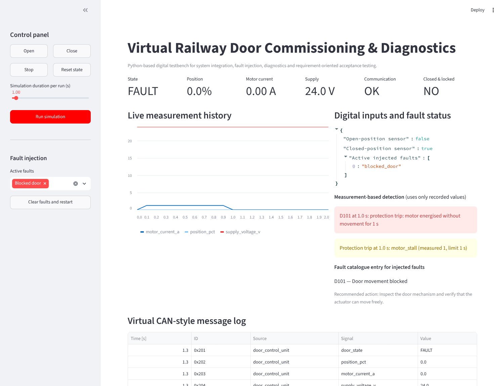
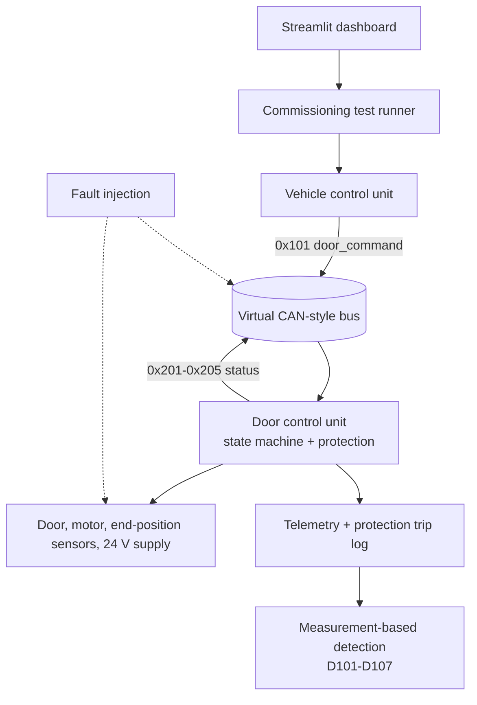
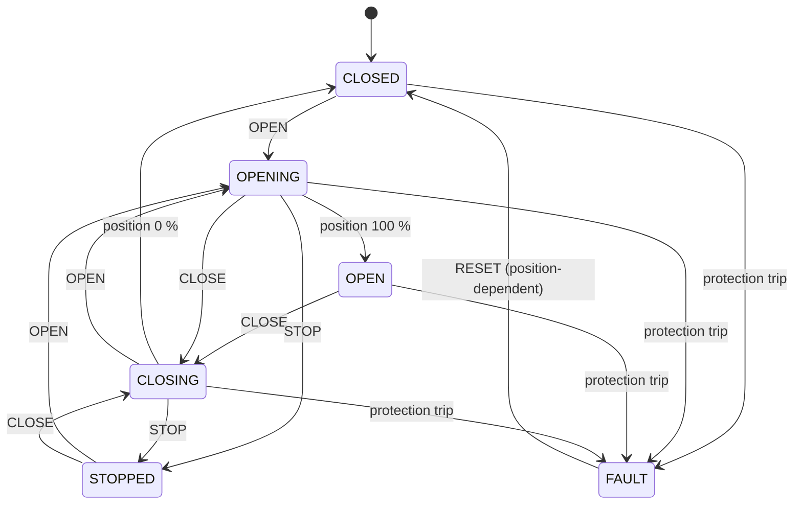
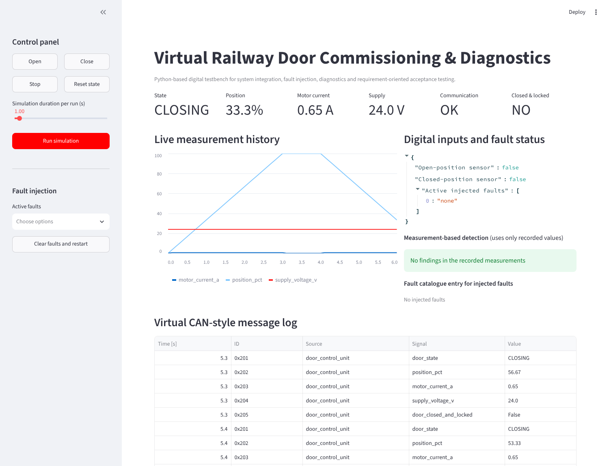

# Virtual Railway Door Commissioning & Diagnostics

[](https://github.com/nivedjpnambiar/railway-commissioning-simulator/actions/workflows/ci.yml)

A Python digital testbench for a simulated **railway passenger-door subsystem**. It
shows virtual commissioning, system integration over a CAN-style interface, fault
injection, protection functions, measurement-based diagnosis and
requirement-oriented acceptance testing.

> Educational low-voltage software simulation. It is not certified railway
> software and is not intended to control real equipment.



## What the project shows

| Topic | In this project |
|---|---|
| State machine | CLOSED, OPENING, OPEN, CLOSING, STOPPED, FAULT with latched safe state |
| Interface | Virtual CAN-style messages between vehicle control unit and door control unit ([spec](docs/interface_specification.md)) |
| Protection | Overcurrent, undervoltage, sensor plausibility, communication timeout, motor stall, movement timeout, all from **measured values and configured limits** |
| Fault injection | 7 fault modes, each with a diagnostic code ([catalog](docs/fault_catalog.md)) |
| Diagnosis | Fault codes found **only from recorded measurements**, not from the injected fault label |
| Commissioning | 11 requirement-based acceptance tests with CSV/HTML report |
| Verification | 39 automated tests, fault matrix, GitHub Actions CI |

## Architecture



## Door state machine



Protection trips (FAULT is latched until RESET):

| Protection | Measured value | Limit (config) | Diagnostic code |
|---|---|---|---|
| Motor overcurrent | motor current | > 1.5 A | D107 |
| Undervoltage | supply voltage | < 19 V | D106 |
| Sensor plausibility | open and closed sensor | both active | D104 |
| Communication timeout | bus status | offline | D105 |
| Motor stall | position while motor energised | unchanged for 1 s | D101 |
| Movement timeout | time in OPENING/CLOSING | > 5 s | - |

The door only reports **closed and locked** (`0x205`, departure permission) when it
is CLOSED, the closed sensor is active and the open sensor is inactive.

## Fault matrix

Each scenario runs the same profile (OPEN at 0 s, CLOSE at 4 s, end at 8 s). The
detection only uses telemetry and protection trips. Regenerate with
`python scripts/generate_docs.py`.

| Scenario | Expected | Detected | Detected at | FAULT at | Protection trip | Closed & locked at end | Result |
|---|---|---|---|---|---|---|---|
| healthy | - | none | - | - | - | yes | PASS |
| blocked_door | D101 | D101 | 1.0 s | 1.0 s | motor_stall | no | PASS |
| open_sensor_failed | D102 | D102 | 3.1 s | - | - | yes | PASS |
| closed_sensor_failed | D103 | D103 | 7.1 s | - | - | **no** (departure inhibited) | PASS |
| contradictory_sensors | D104 | D104 | 0.1 s | 0.1 s | sensor_implausible | no | PASS |
| communication_loss | D105 | D105 | 0.1 s | 0.1 s | communication_timeout | no | PASS |
| undervoltage | D106 | D106 | 0.1 s | 0.1 s | undervoltage (17.5 V) | no | PASS |
| motor_overcurrent | D107 | D107 | 0.1 s | 0.1 s | motor_overcurrent (2.1 A) | no | PASS |

**Healthy cycle:**


**Blocked door:** the motor is energised, the position does not change, stall
protection trips after 1 s:


Plots for all faults: [docs/fault_matrix.md](docs/fault_matrix.md)

## Commissioning and acceptance tests

| Test | Requirement | Result |
|---|---|---|
| TC-001 | The subsystem shall initialize in a safe closed state. | PASS |
| TC-002 | The door shall reach the open end position within 5 s. | PASS |
| TC-003 | The door shall return to the closed end position. | PASS |
| TC-004 | Actuator current shall remain below 1.50 A in normal operation. | PASS |
| TC-005 | A communication loss shall be detected and trigger a safe fault state. | PASS |
| TC-006 | Motor overcurrent shall be diagnosed and motion shall stop. | PASS |
| TC-007 | Contradictory position signals shall be rejected as implausible. | PASS |
| TC-008 | Operation shall be inhibited below 19 V. | PASS |
| TC-009 | A blocked door shall be de-energised within 1.5 s (stall protection). | PASS |
| TC-010 | Departure shall not be permitted without a confirmed closed end position. | PASS |
| TC-011 | A healthy open/close cycle shall produce no findings and permit departure. | PASS |

Sample report: [reports/sample_commissioning_report.html](reports/sample_commissioning_report.html)

## Findings during development

Three problems were found while building the fault matrix and the new tests, and fixed in v1.1 (details in
[docs/design_notes.md](docs/design_notes.md)):

1. **Protection reacted to injected fault labels, not to measurements.** The
   configured limits were never used. The protection now compares measured values
   with the limits and logs every trip.
2. **A blocked door was hidden by a new command.** Every command restarted the
   5 s movement timer, and the blocked current (1.25 A) is below the overcurrent
   limit, so with OPEN then CLOSE the motor stayed energised without FAULT. A
   stall protection now trips after 1 s without movement.
3. **STOP cleared a latched FAULT.** STOP followed by OPEN could move the door
   again without RESET. STOP is now ignored in the FAULT state.

## Dashboard



Suggested demonstration:

1. Run a healthy open and close cycle and look at the measurement history and message log.
2. Inject "Blocked door", press Open and run: D101 and the stall trip appear after 1 s.
3. Inject "Closed sensor failed" and close the door: state CLOSED, but closed & locked = NO.
4. Clear the faults and run the commissioning suite, then download the HTML report.

## Windows setup

Open PowerShell in the project folder:

```powershell
py -m venv .venv
.\.venv\Scripts\Activate.ps1
py -m pip install --upgrade pip
py -m pip install -e ".[dev]"
py -m pytest
py -m streamlit run app.py
```

If PowerShell blocks activation, run this once in the current PowerShell window:

```powershell
Set-ExecutionPolicy -Scope Process -ExecutionPolicy Bypass
```

## macOS / Linux setup

```bash
python3 -m venv .venv
source .venv/bin/activate
python -m pip install -e ".[dev]"
python -m pytest
python -m streamlit run app.py
```

Command-line demo without the dashboard: `python run_demo.py`

## Project structure

```text
railway-commissioning-simulator/
├── app.py                       Streamlit dashboard
├── run_demo.py                  command-line demo
├── railway_commissioning/
│   ├── models.py                states, commands, faults, telemetry, trips
│   ├── simulator.py             door model, state machine, protection
│   ├── bus.py                   virtual CAN-style bus
│   ├── diagnostics.py           fault catalogue and recommendations
│   ├── detection.py             measurement-based fault detection
│   ├── scenarios.py             standard scenario and fault matrix
│   ├── commissioning.py         acceptance tests TC-001 to TC-011
│   ├── plotting.py              SVG plots
│   └── reporting.py             CSV / HTML reports
├── scripts/generate_docs.py     regenerates plots, fault matrix, sample reports
├── tests/                       39 pytest tests
├── docs/                        interface spec, fault catalog, fault matrix, design notes, images
└── reports/                     sample commissioning report
```

## Related project

[cbtc-application-data-toolchain](https://github.com/nivedjpnambiar/cbtc-application-data-toolchain):
definition, validation and release of train control (CBTC/ATC) application data
for fictional metro lines.
